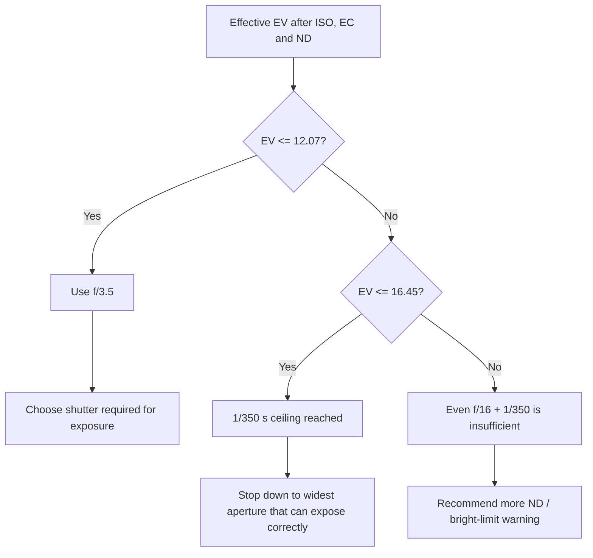
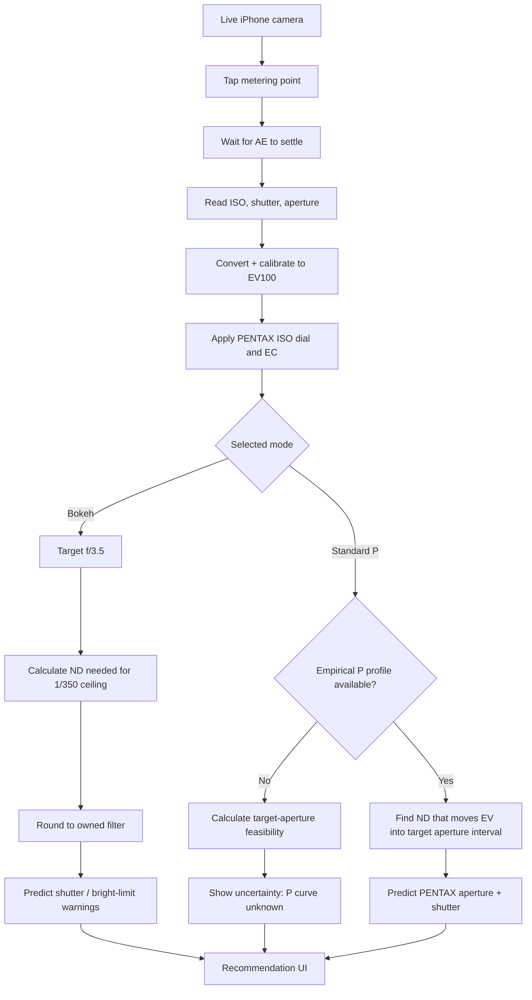

# Building an iOS Light Meter for the PENTAX 17: Program, Bokeh, and ND-Stop Prediction

## Executive summary

The PENTAX 17 is unusually suitable for an ND-planning app because its exposure system is simple enough to model physically, but not simple enough to reproduce exactly from published specifications. The camera has a fixed 25 mm f/3.5 lens, equivalent to approximately 37 mm on 35 mm format; ISO is set manually from 50 through 3200; metering is partial; exposure compensation spans ±2 EV in 1/3-EV increments; and the electronic shutter's stated physical range is 1/350 s to 4 s plus Bulb. The official manual identifies ordinary **Standard** mode as Program AE and **Bokeh** mode as “Maximum aperture priority program AE.” Ricoh's feature page gives the most important behavioral description of Bokeh mode: it selects “the largest aperture available for a given scene.” citeturn17view3turn17view4turn18view2turn17view6

The crucial limitation is the **1/350 s maximum shutter speed**. At f/3.5, 1/350 corresponds to only about **EV 12.07 at the camera's working ISO**. Therefore, at ISO 100 in EV100 15 full sun, f/3.5 would require roughly 1/2675 s—far beyond the camera's shutter. A mathematically ideal “widest feasible aperture” program consequently has to stop down unless roughly **2.93 stops of ND** are placed in front of the lens. A commercially convenient 3-stop ND moves the effective scene to EV 12 and makes f/3.5 require about 1/334 s, just inside the limit. At ISO 400, the same full-sun Bokeh requirement becomes about **4.93 stops**, so a 5-stop filter is the logical recommendation. These numbers follow directly from the standard exposure-value relationship and the PENTAX shutter/aperture constraints. ISO 2720 defines photographic exposure in terms of exposure time, aperture, photosensitive-material speed, and scene light, and defines a one-EV change as a factor of two in exposure. citeturn18view5turn18view6

There is an important distinction between **Bokeh prediction** and **Program-mode sweet-spot prediction**. Bokeh can be modeled with reasonably high confidence because Ricoh actually specifies its priority: choose the largest aperture the scene permits. Standard Program mode is different. Pentax does **not publish the aperture/shutter program line, its aperture transition thresholds, or the aperture actuator's stepping/quantization** in the manual or current official product material. A well-informed independent review describes Standard P as varying the aperture and “aiming for f/8ish,” but explicitly presents those numbers as the author's translation/estimate, not a Pentax specification. citeturn18view0turn17view6turn17view8 Therefore an app can reproduce the **physics** of P mode immediately, but an app that claims to reproduce the exact PENTAX 17 Program algorithm should first obtain an **empirical program map** from a real camera.

Likewise, there is no manufacturer-published “sweet spot” aperture or aperture-by-aperture MTF curve for the PENTAX 17 lens in the material reviewed. Ricoh describes the fixed three-element/three-group HD-coated lens as designed for sharp, clear half-frame images; DPReview reports that its aperture range extends from f/3.5 to f/16. The often-repeated f/8 target is best treated as a **community/engineering heuristic**, not as an official optical specification. citeturn17view4turn17view6turn17view7turn17view8 The app should therefore make `targetAperture` user-selectable and label a default such as f/8 as “estimated,” while treating f/3.5 in Bokeh mode as a much firmer target.

One more point is central to the app's design: on the PENTAX 17, an ND filter can function as a **program-steering device**, not merely an exposure-reduction device. DPReview notes that the metering sensor is positioned at the front of the lens such that an attached 40.5 mm filter is seen by the metering system. The official manual nevertheless warns that dense or colored filters can make correct metering impossible and explicitly recommends test shots and, when needed, compensation; it also warns against stacking filters because of metering-area vignetting. citeturn17view7turn18view3 In other words, putting 3 stops of ND in front of the PENTAX 17 normally encourages AE to compensate with a wider aperture and/or slower shutter. That is precisely the mechanism the proposed app exploits.

The recommended product architecture is consequently **two-tiered**:

**Bokeh mode:** deliver a physics-based, high-confidence ND answer such as “3 stops to keep f/3.5 feasible” and predict the corresponding shutter.

**Standard Program:** initially deliver “f/8 feasibility” plus an explicit confidence indicator; once a measured PENTAX 17 program map is available, upgrade this to a true “ND required to make Program choose f/8” recommendation.

For iOS, AVFoundation exposes the capture device's current ISO, exposure duration and lens-aperture state, supports an exposure point of interest, and indicates whether autoexposure is still adjusting. Those values can be converted into a calibrated EV100 measurement, with a per-device calibration offset rather than assuming an iPhone is an ISO-2720-calibrated photographic meter. citeturn15search5turn16search0turn16search1turn16search2turn16search19 OpenAI's current Codex guidance for iOS specifically recommends a SwiftUI scaffold, a CLI-first `xcodebuild` loop and simulator-backed iteration, with XcodeBuildMCP when deeper build/debug automation is useful. citeturn16search3turn16search11

## What the PENTAX 17 actually does

### Documented hardware and exposure controls

The stock PENTAX 17 does not actually have an unspecified interchangeable “lens model.” It has a **fixed HD PENTAX 25 mm f/3.5 lens**, 3 elements in 3 groups, with a 40.5 mm filter thread. The frame is 24 × 17 mm, giving roughly a 37 mm-equivalent field of view. The maximum aperture is officially f/3.5; DPReview identifies f/16 as the smallest aperture. citeturn17view3turn17view4turn17view7

The app should nevertheless make the optical parameters profile-driven. That protects against future hardware revisions and lets an experimental user substitute empirically measured values.

| Parameter | PENTAX 17 value | Confidence |
|---|---:|---|
| Focal length | 25 mm | Official |
| 35 mm-equivalent | ≈37 mm | Official |
| Maximum aperture | f/3.5 | Official |
| Minimum aperture | f/16 | Strong secondary source |
| Filter thread | 40.5 mm | Official |
| Fastest shutter | 1/350 s | Official |
| Physical automatic shutter range | 1/350 s–4 s | Official |
| Metering | Partial | Official |
| Metering range | EV 2.5–16.5 at ISO 100 | Official |
| ISO choices | 50, 100, 125, 160, 200, 400, 800, 1600, 3200 | Official |
| Exposure compensation | ±2 EV in 1/3-EV steps | Official |
| Auto ISO | **None**; ISO is manually selected | Official |
| Published Program line | **Not published** | Research finding |
| Published aperture-step sequence | **Not published** | Research finding |
| Published optical “sweet spot” | **Not published** | Research finding |

The first six rows and manual-ISO behavior come directly from Ricoh's manual/specification material. citeturn17view3turn17view4turn17view5

### Standard Program mode

The operating manual identifies Standard mode simply as **“Program” / “Program AE,” flash off**, with the user retaining control of the zone-focus ring. Half-pressing the shutter performs metering. Ricoh's consumer-facing description says that in Standard mode the user selects the desired focus zone while the camera adjusts exposure to the proper level. citeturn17view0turn18view0turn17view6

That gives a clear control hierarchy:

| Variable | Standard Program |
|---|---|
| ISO | Fixed at the user's ISO-dial setting |
| Exposure compensation | User-set ±2 EV |
| Aperture | Automatically selected |
| Shutter | Automatically selected |
| Flash | Off |
| Focus distance | User selects zone |
| User program shift | None documented |
| Auto ISO | None |
| Exact aperture/shutter program curve | Undocumented |

This is **not** analogous to a modern digital-camera P mode with a user-accessible “program shift” dial. The PENTAX 17 exposes no control that directly rotates through equivalent aperture/shutter pairs. ND, ISO/EI and exposure compensation can influence where the camera lands on its internal program, but that is indirect steering of AE rather than a documented program-shift function. The manual exposes only the shooting-mode, ISO and exposure-compensation controls relevant here. citeturn18view0turn17view2turn17view3

There is useful but non-official evidence about the hidden program. Analogue Wonderland's detailed review characterizes white P as varying its aperture and “aiming for f/8ish.” The same author explicitly introduces the accompanying aperture/shutter table as his own attempt to translate the modes into numbers, so f/8 must **not** be treated as a guaranteed camera setpoint. citeturn17view8 A separate technical overview from Kamerastore states that normal Program mode is kept at 1/30 s or faster while the slow-speed mode covers the longer range; however, the official manual does not state a Standard-P 1/30-s floor, so this should remain a profile parameter until measured. citeturn21search15turn18view0

### Bokeh / Maximum-aperture-priority mode

This mode has much stronger documentation. The operating manual calls it **“Maximum aperture priority program,”** and Ricoh's feature page says that the camera “automatically sets the largest aperture available for a given scene.” citeturn18view0turn17view6 DPReview describes it similarly as keeping the lens at its widest possible aperture. citeturn17view7

That wording is more nuanced than “Bokeh always equals f/3.5.” In dim or moderate light, f/3.5 is the largest available aperture and is therefore the obvious target. But in sufficiently bright light, f/3.5 may require a shutter faster than 1/350. Since the camera cannot create that shutter speed, “largest aperture available for a given scene” logically implies that it must **stop down enough to remain within the exposure envelope**. That second sentence is an inference from Ricoh's documented priority plus its documented 1/350-s ceiling, rather than a published Ricoh program equation. citeturn17view6turn18view2

An idealized continuous model is therefore:

\[
N_{\mathrm{Bokeh}} =
\begin{cases}
3.5, & V \le \log_2(350 \cdot 3.5^2)\\[4pt]
\sqrt{\frac{2^V}{350}}, &
\log_2(350 \cdot 3.5^2)<V\le\log_2(350\cdot 16^2)
\end{cases}
\]

where \(V\) is the effective exposure value after ISO, compensation and ND have been accounted for.

Above f/3.5's bright boundary, the ideal model pins shutter speed to approximately 1/350 and progressively closes the aperture. The real camera may quantize this onto discrete aperture positions; **the published documentation does not say whether those positions are full stops, half stops, third stops, or something else**. That unknown must remain explicit in the software rather than being invented.

### Exposure compensation and ISO

Exposure compensation is available from –2 to +2 EV in 1/3-EV increments. The manual says it can deliberately brighten or darken photographs; it is disabled in Bulb mode. citeturn17view1turn17view2

For the proposed equations, define \(C\) using conventional camera semantics:

- \(C=+1\): request one stop **more** exposure.
- \(C=-1\): request one stop **less** exposure.

The useful consequence is that +1 EV compensation reduces the aperture/shutter EV demanded of the camera by one stop.

ISO is entirely different from modern auto-ISO behavior: the PENTAX 17 requires the photographer to select one of its discrete ISO values to match—or intentionally differ from—the film. There is no automatic ISO variable available to the program. citeturn17view3turn17view6 This is very important for the simulator: **ISO must be an input, never an optimization variable.**

It is useful for the app to distinguish:

\[
S_{\mathrm{film}}
\]

from

\[
S_{\mathrm{dial/EI}}
\]

even though they normally match. Camera behavior follows the **dial setting**; a mismatch from box speed represents intentional exposure-index bias and should generate an informational warning.

### Other modes clarify the design

The official mode table is useful because it confirms that Pentax intentionally separated ordinary Program, Slow-speed Program and Maximum-aperture-priority Program. Slow-speed mode is the mode explicitly associated with automatic shutter delays up to four seconds. Bulb fixes aperture at f/3.5, and both ISO sensitivity and exposure compensation are disabled during Bulb exposures. citeturn18view0turn18view4

That distinction is why the application should not blindly assume “all automatic modes use the entire 4 s–1/350 s physical range.” The 4-second limit is a physical/specification maximum, while each program can impose narrower policy constraints. Ricoh explicitly describes up-to-four-second operation for the slow modes, not for ordinary Standard P or Bokeh. citeturn18view0turn18view2

### The “sweet spot” question

There is no defensible basis in the sources reviewed for saying “Pentax officially says the 17 is sharpest at f/8.” Ricoh says that the HD-coated three-element lens is designed for sharp half-frame images, but does not publish a best-aperture recommendation or aperture-resolved MTF chart on the cited product material. citeturn17view4turn17view6

A useful hierarchy for the app is therefore:

| Target | Meaning | Confidence |
|---|---|---:|
| f/3.5 | Actual maximum aperture; natural Bokeh target | High |
| f/8 | Independent review says P mode “aims for f/8ish” | Low/medium |
| User-selected f/5.6–f/11 | Photographer's preferred optical/DoF target | User-defined |
| “PENTAX 17 optical sweet spot = f/8” | **Do not assert as fact** | Unsupported |

The sensible default is consequently something like **“Preferred aperture: f/8 — estimated, editable.”** citeturn17view8

The user's phrase **“sunny 1.4”** is ambiguous. I treat it below as a bright-sun scenario and include EV100 14–15. If it literally means an f/1.4 target, that is impossible on a stock PENTAX 17 because the fixed lens opens only to f/3.5. citeturn17view4

## Exposure physics and the 1/350-second boundary

### EV model

ISO 2720 describes photographic exposure as a function of exposure time, aperture, film speed and scene light, and defines a one-EV step as a factor-of-two change in exposure. citeturn18view5turn18view6 Using the conventional APEX form,

\[
V = \log_2 \left(\frac{N^2}{t}\right)
\]

where:

- \(V\) = exposure value represented by the camera settings,
- \(N\) = f-number,
- \(t\) = exposure time in seconds.

Normalize the app's light reading to EV100 and call it:

\[
E_{100}
\]

Let:

- \(S\) = PENTAX ISO-dial value,
- \(C\) = exposure compensation in EV,
- \(D\) = effective ND attenuation in stops.

Then the settings EV the PENTAX must produce after the filter is:

\[
\boxed{
V = E_{100} + \log_2\left(\frac{S}{100}\right)-C-D
}
\]

The sign conventions are worth testing carefully:

- brighter scene → larger \(V\);
- higher ISO → larger \(V\), because less film exposure is required;
- positive EC → smaller \(V\), because the camera is asked to expose more;
- more ND → smaller \(V\), because less light reaches the PENTAX metering/exposure path.

### Why 1/350 is the key number

For a desired aperture \(N\), the highest settings EV attainable before the shutter runs out of speed is:

\[
\boxed{
V_{\max}(N)=
\log_2(350N^2)
}
\]

This produces the following boundaries:

| Aperture | Highest usable settings EV at 1/350 |
|---:|---:|
| f/3.5 | **12.07** |
| f/4 | 12.45 |
| f/5.6 | 13.42 |
| f/8 | **14.45** |
| f/11 | 15.37 |
| f/16 | **16.45** |

These are derived values from the PENTAX 17's 1/350-s limit, official f/3.5 maximum aperture and independently reported f/16 minimum aperture. citeturn17view4turn18view2turn17view7

This table immediately explains Bokeh behavior.

At ISO 100, EC 0:

- EV100 12.07 or darker can theoretically use f/3.5 without exceeding 1/350.
- Above EV100 12.07, f/3.5 requires a faster-than-available shutter, so the no-ND Bokeh program must close down.
- Above EV100 16.45, even f/16 + 1/350 is insufficient for nominal exposure.

At higher ISO, these scene-light thresholds move downward. With ISO 400, for example, the camera needs two stops less exposure, so the f/3.5 bright-scene threshold occurs at only:

\[
12.07-2=10.07\ \text{EV}_{100}.
\]

This is why fast film and a 1/350-s shutter are a particularly difficult combination for wide-aperture daylight photography.

### How much ND is required?

Rearranging the equation gives the core app calculation:

\[
\boxed{
D_{\min}
=
\max\left[
0,\
E_{100}+
\log_2\left(\frac{S}{100}\right)
-C
-
\log_2(350N^2)
\right]
}
\]

For Bokeh, set \(N=3.5\).

For a provisional “sweet-spot feasibility” calculation, set \(N=8\), or whatever aperture the user chooses.

Note the phrase **feasibility**. At f/8 this equation proves that the PENTAX *could* expose correctly at f/8 without needing more than 1/350. It does **not** prove that Standard P will actually choose f/8, because Pentax has not published that program curve.

If the UI recommends ND in 1/3-stop increments, round upward:

\[
D_{\mathrm{1/3}}=
\frac{
\left\lceil 3D_{\min}\right\rceil
}{3}.
\]

For a user's actual filter inventory, a better algorithm is to choose the smallest available ND value \(D_i\) satisfying:

\[
D_i\ge D_{\min}.
\]

### Program steering versus merely blocking light

This distinction is easy to miss. The PENTAX 17's metering arrangement allows a filter mounted on its 40.5 mm thread to influence the meter, and independent testing descriptions therefore expect the camera to compensate for filters. Pentax itself nevertheless warns that dense filters may defeat accurate metering and recommends testing/compensation. citeturn17view7turn18view3

So in a normal AE use case:

**No filter:** bright light pushes the program toward a fast shutter and/or small aperture.

**Add ND:** the camera sees less light and compensates by slowing its shutter and/or opening the aperture.

Therefore the purpose of ND in this app is often:

> **move the PENTAX program into a more desirable aperture region while preserving nominal film exposure.**

It should not be presented simply as “subtract three stops from the film exposure.”

### Idealized Bokeh curve

The physically useful Bokeh model is:

\[
V_{3.5}=12.066
\]

and, assuming a continuous aperture actuator:

\[
(N,t)=
\begin{cases}
\left(3.5,\frac{3.5^2}{2^V}\right), & V\le12.066\\[6pt]
\left(\sqrt{\frac{2^V}{350}}, \frac{1}{350}\right),
&12.066<V\le16.451
\end{cases}
\]

with an over-range condition above 16.451.



The policy in the diagram follows Ricoh's “largest aperture available for a given scene”; the continuous aperture equation itself is an engineering approximation because the real aperture-step lattice is undocumented. citeturn17view6turn18view2

### The hard bright-limit versus the creative target

It is useful to calculate three different ND quantities:

\[
D_{\text{survival}}=D_{\min}(f/16)
\]

is enough to put *some* nominal exposure within the camera's physical range.

\[
D_{\text{sweet}}=D_{\min}(f/8)
\]

makes f/8 physically possible.

\[
D_{\text{Bokeh}}=D_{\min}(f/3.5)
\]

makes wide-open Bokeh physically possible.

For full sun, EV100 15, EC 0:

| ISO | Minimum ND just to remain inside f/16 + 1/350 | ND to make f/8 feasible | ND to make f/3.5 feasible |
|---:|---:|---:|---:|
| 100 | 0 | 0.55 EV → ⅔ stop | 2.93 EV → **3 stops** |
| 200 | 0 | 1.55 EV → 1⅔ | 3.93 EV → **4** |
| 400 | 0.55 EV → ⅔ | 2.55 EV → 2⅔ | 4.93 EV → **5** |
| 800 | 1.55 EV → 1⅔ | 3.55 EV → 3⅔ | 5.93 EV → **6** |
| 1600 | 2.55 EV → 2⅔ | 4.55 EV → 4⅔ | 6.93 EV → **7** |
| 3200 | 3.55 EV → 3⅔ | 5.55 EV → 5⅔ | 7.93 EV → **8** |

The calculations use EV100 15 as a representative bright-sun level. The classic Sunny 16 rule likewise corresponds to approximately f/16 at the reciprocal of ISO in direct sun. citeturn21search25

This is arguably the application's most valuable table: it explains immediately why **ISO 400 + bright sun + PENTAX 17 Bokeh mode wants around ND5**.

## ND recommendations and worked scenarios

### Bright sun

Take:

\[
E_{100}=15,\quad S=100,\quad C=0.
\]

Without ND, attempting f/3.5 requires

\[
t=\frac{3.5^2}{2^{15}}
=\frac{12.25}{32768}
\approx0.000374\ \text{s}
\]

or approximately:

\[
\boxed{1/2675\ \text{s}}
\]

which is about 2.93 stops faster than the PENTAX can deliver.

Therefore:

\[
D_{\min}
=15-12.066
=2.934
\]

so the app should display approximately:

> **Bokeh target f/3.5: 3-stop ND**

With exactly 3 stops installed,

\[
V=15-3=12
\]

and

\[
t=\frac{12.25}{2^{12}}
\approx1/334\ \text{s}.
\]

That is comfortably inside the 1/350-s ceiling.

For an f/8 target:

\[
t_{f/8,\ noND}
=\frac{64}{2^{15}}
=1/512\ \text{s}
\]

so f/8 is only 0.55 EV beyond the shutter limit. A 2/3-stop ND is the mathematical minimum if third-stop ND values exist; an ordinary 1-stop ND yields:

\[
V=14,\qquad t=\frac{64}{2^{14}}=1/256\ \text{s}.
\]

The app should phrase this differently in P mode:

> **“⅔ stop minimum for f/8 to be exposure-feasible; 1-stop filter from your kit. Exact P-mode aperture not guaranteed.”**

That last qualification follows from the absence of an official Pentax program curve. citeturn18view0turn17view8

At ISO 400 in the same sunlight:

\[
V_0=15+\log_2(4)=17.
\]

Bokeh now needs:

\[
17-12.066=4.934
\]

stops, hence an **ND5** recommendation.

This is also a case where the camera's absolute exposure envelope is stressed: even f/16 + 1/350 reaches only EV 16.45, leaving the no-filter scene about 0.55 EV beyond nominal capability. A roughly 2/3-stop minimum filter moves it back within the physical envelope; about 5 stops are required specifically to recover f/3.5.

### Hazy or softer sun

For EV100 14, ISO 100, EC 0:

\[
D_{\mathrm{Bokeh}}
=14-12.066
=1.934
\]

so:

> **≈2 stops ND for f/3.5.**

At f/8:

\[
14 < 14.451,
\]

so no ND is mathematically required merely to make f/8 feasible.

At ISO 400, add two EV to the camera requirement:

\[
D_{\mathrm{Bokeh}}
=16-12.066
=3.934,
\]

hence approximately **ND4**.

The EV100 14 line is useful in the UI because real “sunny” conditions are not always the textbook EV15 direct-sun case. Typical EV tables also distinguish full sun, hazy sun and cloudy conditions rather than treating daylight as one fixed exposure. citeturn17view9

### Bright cloudy / overcast daylight

Take EV100 13.

At ISO 100 and f/3.5:

\[
t=\frac{12.25}{8192}\approx1/669\ \text{s},
\]

which is still too fast for the PENTAX.

\[
D_{\min}=13-12.066=0.934
\]

so a **1-stop ND** brings the exposure to roughly:

\[
V=12,\qquad t\approx1/334.
\]

Thus a surprisingly small filter is enough to recover genuine wide-open Bokeh behavior in bright overcast conditions.

At f/8 with no ND:

\[
t=\frac{64}{8192}=1/128\ \text{s}.
\]

That is comfortably inside the physical envelope; again, it does not establish that Standard P will actually choose f/8.

At ISO 400, the same cloudy scene becomes camera EV 15 and therefore requires the same Bokeh ND as ISO-100 full sun: approximately **3 stops**.

### Indoor office light

Use EV100 ≈8 as a representative reasonably illuminated interior value; indoor EV varies substantially, so the live meter rather than the example constant should always drive the actual app. Common EV reference tables place typical working interiors many stops below daylight. citeturn17view9

At ISO 100 and f/3.5:

\[
t=\frac{12.25}{256}\approx0.0479\ \text{s}
\]

or roughly:

\[
\boxed{1/21\ \text{s}}.
\]

No ND is useful: it would merely force a longer exposure.

At f/8:

\[
t=\frac{64}{256}=0.25\ \text{s}.
\]

Again, physically possible, but almost certainly not what a handheld-oriented normal program would want if it has a faster-shutter policy. This illustrates why **f/8 feasibility and f/8 Program prediction are fundamentally different concepts**.

At ISO 400:

\[
V=8+2=10,
\]

so f/3.5 requires approximately:

\[
t=\frac{12.25}{1024}\approx1/84\ \text{s}.
\]

That is already comfortably below the 1/350 bright limit, making ND unnecessary for Bokeh.

### Dim home interior

At EV100 6, ISO 100:

\[
t_{3.5}\approx1/5.2\ \text{s}
\]

and

\[
t_8=1\ \text{s}.
\]

Neither needs ND. Here the important problem is no longer the fast-shutter limit but **camera shake and each mode's undocumented/partly documented slow-shutter policy**. The PENTAX manual specifically provides Slow-speed mode for long automatic exposures and states that those slow programs can extend to four seconds. citeturn18view0turn18view2

The UX should therefore change its recommendation from “ND” to something like:

> **No ND. Light is already below the wide-aperture bright limit. For longer exposures, consider Slow-speed mode/tripod.**

### Scenario comparison

The following numbers are **minimum ND to make the target physically feasible at 1/350**, rounded upward to 1/3 stop. They are not a claim about Standard P's unpublished program line.

| Scene | EV100 | ISO | Bokeh f/3.5 | f/8 feasibility | Interpretation |
|---|---:|---:|---:|---:|---|
| Full sun | 15 | 100 | **3** | ⅔ | ND3 is the headline Bokeh case |
| Hazy/soft sun | 14 | 100 | **2** | 0 | Wide open needs ND2 |
| Bright cloudy | 13 | 100 | **1** | 0 | ND1 enough for wide-open feasibility |
| Office interior | 8 | 100 | 0 | 0 | No ND; shutter becomes the concern |
| Dim home | 6 | 100 | 0 | 0 | No ND; use low-light strategy |
| Full sun | 15 | 400 | **5** | 2⅔ | Fast film makes wide-open daylight difficult |
| Hazy/soft sun | 14 | 400 | **4** | 1⅔ | ND4 for Bokeh |
| Bright cloudy | 13 | 400 | **3** | ⅔ | ND3 for Bokeh |
| Office interior | 8 | 400 | 0 | 0 | No ND needed |
| Full sun | 15 | 800 | **6** | 3⅔ | Very strong ND needed for f/3.5 |
| Bright cloudy | 13 | 800 | **4** | 1⅔ | Still significant ND |

### How exposure compensation changes the recommendation

Because

\[
D_{\min}\propto -C,
\]

a +1-EV compensation setting reduces the ND needed to keep a particular aperture within 1/350 by one stop:

\[
D_{\min}(C=+1)
=
D_{\min}(C=0)-1.
\]

For example, ISO 100 / EV15 / Bokeh:

- EC 0 → 2.93 stops
- EC +1 → 1.93 stops
- EC –1 → 3.93 stops

This can initially look backwards, but it is correct: +EC commands more exposure, so the camera is permitted to use a slower shutter for the same f/3.5 opening.

The application must also recognize a real-world complication: Pentax itself recommends using exposure compensation if a dense or colored filter does not meter correctly. citeturn18view3 Therefore the UI should distinguish **creative/user EC** from any **filter-meter calibration offset**, rather than silently combining them.

## App UX and metering design

### The main screen should answer one question immediately

The primary display should not look like a generic photography calculator. It should answer:

> **“What ND should I put on my PENTAX 17 right now?”**

A practical main readout could be:

**Scene**  
`EV100 15.1 ±0.2`

**Camera**  
`ISO 100 · Bokeh · EC 0`

**Target**  
`f/3.5`

**Recommendation**  
`ND 3 stops`

**Prediction**  
`≈ f/3.5 · 1/312 s after ND3`

**Confidence**  
`High — physics + documented Bokeh priority`

For Standard P:

**Target**  
`Preferred aperture f/8`

**Recommendation**  
`ND 1 stop from your filter kit`

**Prediction**  
`f/8 is exposure-feasible; exact P-mode aperture unknown`

**Confidence**  
`Medium/Low until camera profile is calibrated`

This prevents the application from implying false precision.

### Recommended user inputs

Most inputs belong in compact controls around the meter, not in a setup wizard.

| Input | Default / behavior | Why |
|---|---|---|
| PENTAX mode | P or Bokeh | Changes prediction algorithm |
| Film ISO | User selects film | Records actual stock |
| Camera ISO/EI | Defaults to film ISO | Camera behavior follows dial setting |
| EC | 0 EV | Mirrors PENTAX dial |
| Preferred aperture | f/8 heuristic | User-editable |
| Filter inventory | e.g. 1, 2, 3, 4, 5, 6 stops | Recommend something user owns |
| Metering target | Tap point | Controls iPhone AE ROI |
| Calibration offset | Per iPhone/camera | Improves EV accuracy |
| Camera profile | P17 stock / empirical revision | Versions hidden-program data |

The ISO selector should contain the actual PENTAX choices—50, 100, 125, 160, 200, 400, 800, 1600 and 3200—rather than a free-form digital-camera ISO slider. citeturn17view3turn17view6

### Outputs worth showing

The most useful output is not merely an integer ND number. Show:

**Exact requirement:** `2.93 stops`

**Available-filter recommendation:** `Use ND3`

**Predicted headroom:** `0.07 EV`

**Expected aperture/shutter:** `f/3.5 ≈ 1/334`

**No-filter prediction:** `f/3.5 would require ≈1/2675`

**Reason:** `PENTAX 17 limited to 1/350`

For P mode, add:

**Target status:** `f/8 physically feasible`

**Program confidence:** `Uncalibrated`

This gives a technically inclined photographer enough information to trust—or question—the recommendation.

### Warnings should be mode-specific

The app should distinguish several conditions that otherwise all collapse into “too bright” or “too dark.”

| Condition | Suggested warning |
|---|---|
| \(V > 16.45\) with no ND | “Beyond f/16 + 1/350 nominal exposure envelope.” |
| Bokeh requires ND | “Without ND, Bokeh mode must stop down.” |
| Target f/8 feasible but P curve unknown | “P mode may choose another aperture.” |
| Dense ND selected | “PENTAX warns dense filters can affect metering; test/calibrate.” |
| Multiple filters | “Avoid stacking: Pentax warns of metering-area vignetting.” |
| ISO dial differs from film | “Camera EI differs from film box speed by X EV.” |
| Very low light | “ND not recommended; shutter/handholding is the limiting factor.” |
| Requested f/1.4 | “PENTAX 17 maximum aperture is f/3.5.” |

The dense-filter and filter-stacking cautions come directly from the operating manual. citeturn18view3

### Meter behavior on iPhone

AVFoundation provides the pieces needed for a pragmatic reflected-light meter: the current capture-device ISO and exposure duration, lens-aperture information, exposure point of interest and an `isAdjustingExposure` indicator. citeturn15search5turn16search0turn16search1turn16search2turn16search19

Using the iPhone camera's current AE solution:

\[
E_{100,\mathrm{iPhone}}
=
\log_2\left(
\frac{A_i^2}{t_i}
\right)
-
\log_2\left(
\frac{ISO_i}{100}
\right)
+
K_{\mathrm{device}}
\]

where \(K_{\mathrm{device}}\) is a calibration correction determined against a trusted photographic meter or standardized target.

That calibration term is important. The app should **not** advertise an uncalibrated iPhone AE solution as an ISO-2720 traceable luminance measurement. ISO 2720 defines calibration and test conditions for photographic exposure meters, while AVFoundation's documented values are camera-exposure controls; nothing in the Apple documentation cited here establishes that an arbitrary iPhone/camera module has been calibrated as a standalone ISO-2720 exposure meter. citeturn18view5turn15search5turn16search2

A good acquisition loop is:

1. Keep one selected rear camera rather than allowing automatic lens switching.
2. Let the user tap the region of interest; AVFoundation supports an exposure point of interest. citeturn16search0
3. Wait until `isAdjustingExposure == false`. citeturn16search1
4. Collect several AE readings over a short interval.
5. Convert each to EV100.
6. Use a median/robust average.
7. Report dispersion as an uncertainty estimate.
8. Freeze the reading until the user meters again.

The app will require camera authorization and an `NSCameraUsageDescription` entry, as documented by Apple. citeturn15search2turn15search4

### Recommended flow



## Codex-assisted iOS implementation

### Keep the exposure engine pure

The most important architectural choice is to keep camera capture, PENTAX simulation and UI separate. That lets almost every meaningful exposure calculation be unit-tested without an iPhone camera or Simulator camera feed.

A reasonable model is:

```swift
struct ExposureReading: Equatable, Sendable {
    let ev100: Double
    let uncertaintyEV: Double
}

struct Pentax17Profile: Equatable, Sendable {
    let maxAperture: Double       // 3.5
    let minAperture: Double       // 16.0
    let fastestShutter: Double    // 1.0 / 350.0

    // Keep program-specific slow limits optional until measured.
    let standardSlowestShutter: Double?
    let bokehSlowestShutter: Double?

    let supportedISO: [Int]

    // User/community heuristic, not manufacturer specification.
    let preferredAperture: Double

    // Optional measured profile.
    let standardProgramMap: ProgramMap?
}

enum PentaxMode: Sendable {
    case standardProgram
    case bokeh
}

struct MeteringConfiguration: Sendable {
    let filmISO: Int
    let cameraISO: Int
    let exposureCompensationEV: Double
    let mode: PentaxMode
    let targetAperture: Double
}
```

The stock profile would be based on Ricoh's official exposure specifications and the independently reported f/16 minimum. citeturn17view3turn17view4turn18view2turn17view7

### Core exposure functions

```swift
import Foundation

enum ExposureMath {
    static func settingsEV(
        sceneEV100: Double,
        cameraISO: Int,
        exposureCompensationEV: Double,
        ndStops: Double
    ) -> Double {
        precondition(cameraISO > 0)

        return sceneEV100
            + log2(Double(cameraISO) / 100.0)
            - exposureCompensationEV
            - ndStops
    }

    static func ev(aperture: Double, shutterSeconds: Double) -> Double {
        precondition(aperture > 0)
        precondition(shutterSeconds > 0)

        return log2((aperture * aperture) / shutterSeconds)
    }

    static func shutterSeconds(
        aperture: Double,
        settingsEV: Double
    ) -> Double {
        precondition(aperture > 0)

        return aperture * aperture / pow(2.0, settingsEV)
    }

    static func maxEV(
        aperture: Double,
        fastestShutterSeconds: Double
    ) -> Double {
        precondition(aperture > 0)
        precondition(fastestShutterSeconds > 0)

        return ev(
            aperture: aperture,
            shutterSeconds: fastestShutterSeconds
        )
    }

    static func minimumNDStops(
        sceneEV100: Double,
        cameraISO: Int,
        exposureCompensationEV: Double,
        targetAperture: Double,
        fastestShutterSeconds: Double
    ) -> Double {
        let unfilteredEV = settingsEV(
            sceneEV100: sceneEV100,
            cameraISO: cameraISO,
            exposureCompensationEV: exposureCompensationEV,
            ndStops: 0
        )

        let limit = maxEV(
            aperture: targetAperture,
            fastestShutterSeconds: fastestShutterSeconds
        )

        return max(0, unfilteredEV - limit)
    }

    static func roundUp(
        stops: Double,
        increment: Double = 1.0 / 3.0
    ) -> Double {
        precondition(increment > 0)

        return ceil((stops / increment) - 1e-12) * increment
    }
}
```

The tiny epsilon before `ceil` avoids a floating-point boundary such as `3.0000000000000004` becoming 3⅓ stops.

### Bokeh predictor

The Bokeh implementation should encode the documented **priority**, while clearly describing its aperture interpolation as an engineering model.

```swift
struct PredictedExposure: Equatable, Sendable {
    let aperture: Double
    let shutterSeconds: Double
    let overRange: Bool
}

func predictIdealizedBokeh(
    effectiveEV: Double,
    profile: Pentax17Profile
) -> PredictedExposure {
    let wideOpenLimit = ExposureMath.maxEV(
        aperture: profile.maxAperture,
        fastestShutterSeconds: profile.fastestShutter
    )

    let absoluteLimit = ExposureMath.maxEV(
        aperture: profile.minAperture,
        fastestShutterSeconds: profile.fastestShutter
    )

    if effectiveEV <= wideOpenLimit {
        let shutter = ExposureMath.shutterSeconds(
            aperture: profile.maxAperture,
            settingsEV: effectiveEV
        )

        return .init(
            aperture: profile.maxAperture,
            shutterSeconds: shutter,
            overRange: false
        )
    }

    guard effectiveEV <= absoluteLimit else {
        return .init(
            aperture: profile.minAperture,
            shutterSeconds: profile.fastestShutter,
            overRange: true
        )
    }

    // Ideal continuous solution: widest aperture compatible
    // with the 1/350 s ceiling.
    let aperture = sqrt(
        pow(2.0, effectiveEV) * profile.fastestShutter
    )

    return .init(
        aperture: aperture,
        shutterSeconds: profile.fastestShutter,
        overRange: false
    )
}
```

In production, the output should say something like **“estimated f/5.1 equivalent”** rather than implying the physical iris literally has an f/5.1 detent, unless empirical testing establishes the actual aperture lattice.

### Standard Program requires a map, not guesswork

The right representation for the hidden Pentax program is not a single “f/8” constant. It is an EV-indexed map.

For example:

```swift
struct ProgramBin: Codable, Equatable, Sendable {
    let minimumEV: Double
    let maximumEV: Double
    let aperture: Double
    let shutterPolicy: ShutterPolicy
}

enum ShutterPolicy: Codable, Equatable, Sendable {
    case computed
    case pinned(seconds: Double)
}

struct ProgramMap: Codable, Equatable, Sendable {
    let profileID: String
    let source: String
    let bins: [ProgramBin]
}
```

Suppose empirical testing eventually shows that Standard P selects f/8 over the post-filter EV interval:

\[
V\in[V_L,V_H].
\]

Let:

\[
V_0 =
E_{100}+
\log_2(S/100)-C.
\]

Since filtering yields:

\[
V=V_0-D,
\]

the ND values that place the camera in the f/8 region are:

\[
\boxed{
D\in
[V_0-V_H,\;V_0-V_L]
}
\]

after intersecting with \(D\ge0\).

That is considerably more rigorous than “add ND until the formula says f/8.”

The app can then choose the smallest user's filter in that valid interval, or preferably one near its center to retain tolerance against ±0.2–0.3 EV metering/calibration error.

### Reverse-engineering the Standard P program

Because the missing information is empirical rather than mathematical, a calibration experiment is the cleanest route.

Use a stable, uniform target and a trusted reference meter. Sweep target illumination across a broad EV range in perhaps 1/3-EV increments. For each point, test P and Bokeh at a fixed ISO and EC, then repeat at enough ISO/EC settings to verify whether they merely shift the EV axis as expected.

What needs to be recovered is:

\[
V\rightarrow(N,t)
\]

for each mode.

Shutter duration can be measured much more reliably with a photodiode/light sensor and timestamped acquisition than by listening to shutter sounds. Aperture can be imaged during actuation or inferred from a sufficiently well-controlled optical experiment once shutter duration and incident illumination are known. This is a proposed experimental method, not a published Pentax procedure.

The resulting profile should be checked into the application as data, not hidden in conditional code:

```text
Resources/
  CameraProfiles/
    pentax17-stock-empirical-v1.json
```

and include provenance:

```json
{
  "camera": "PENTAX 17",
  "profileVersion": "1.0",
  "measurementDate": "2026-...",
  "sampleCameraSerialHash": "...",
  "iso": 100,
  "ec": 0,
  "uncertaintyEV": 0.15,
  "source": "empirical"
}
```

This also solves the user's unspecified-firmware issue. I found no official published PENTAX 17 exposure-algorithm version identifier in the operating materials reviewed; instead of assuming that every future body behaves identically, simply version the app's camera profile independently. Ricoh's current support material does provide a dedicated PENTAX 17 FAQ and operating manual. citeturn20search1turn20search3

### AVFoundation metering layer

Apple documents a point-of-interest exposure mechanism as well as current ISO/exposure properties and an exposure-adjusting state. citeturn16search0turn16search1turn15search5turn16search2 The implementation can wrap those behind a protocol:

```swift
protocol LightMeter: Sendable {
    func meter(at normalizedPoint: CGPoint?) async throws -> ExposureReading
}
```

with:

```swift
final class AVFoundationLightMeter: LightMeter {
    // AVCaptureSession + selected AVCaptureDevice
}

struct FakeLightMeter: LightMeter {
    let reading: ExposureReading

    func meter(at normalizedPoint: CGPoint?) async throws -> ExposureReading {
        reading
    }
}
```

The fake implementation is valuable because UI, recommendation and boundary testing should not depend on an actual camera.

A production metering sequence should conceptually be:

```text
authorize camera
→ configure fixed rear camera
→ set exposure point
→ request/allow auto exposure
→ wait for exposure adjustment to settle
→ sample aperture / duration / ISO several times
→ convert each sample to EV100
→ apply device calibration offset
→ reject unstable/outlier samples
→ return median EV + uncertainty
```

Camera access must use Apple's authorization flow and include `NSCameraUsageDescription`. citeturn15search2turn15search4

### Recommendation engine

A clean output type keeps exact mathematics separate from UI wording:

```swift
enum RecommendationConfidence: Sendable {
    case high
    case medium
    case experimental
}

struct NDRecommendation: Sendable {
    let exactStops: Double
    let suggestedStops: Double?
    let predictedExposure: PredictedExposure?
    let confidence: RecommendationConfidence
    let warnings: [RecommendationWarning]
}
```

The algorithm is then approximately:

```text
INPUT:
  EV100
  camera ISO/EI
  film ISO
  EC
  mode
  target aperture
  user's filters
  camera profile

Compute:
  V0 = EV100 + log2(cameraISO / 100) - EC

IF Bokeh:
  Dmin = max(0, V0 - Vmax(f/3.5))
  choose smallest available filter >= Dmin
  predict Bokeh exposure after chosen ND
  confidence = high for wide-open feasibility
  warn if dense-filter calibration is unknown

IF Standard P AND empirical profile exists:
  find program EV interval(s) containing target aperture
  transform interval(s) into valid ND interval(s)
  choose owned filter within interval
  confidence = empirical-profile confidence

IF Standard P AND no empirical profile:
  Dmin = max(0, V0 - Vmax(targetAperture))
  label result "target-aperture feasibility"
  do NOT claim Pentax will select that aperture
  confidence = experimental/medium-low

IF filmISO != cameraISO:
  show EI difference

IF V after filter > Vmax(f/16):
  issue hard bright-limit warning

IF predicted shutter exceeds verified mode's slow limit:
  issue low-light/program-limit warning
```

### Codex workflow

OpenAI's current iOS Codex guidance explicitly recommends having Codex scaffold SwiftUI applications while retaining a command-line-first build loop using `xcodebuild` or Tuist; for existing projects it recommends discovering the actual scheme/simulator and using simulator evidence rather than editing without validation. XcodeBuildMCP is suggested when a deeper automated Xcode/Simulator loop is appropriate. citeturn16search3turn16search6turn16search11

A productive first Codex task would therefore be framed around a **vertical slice**, not “build the whole light-meter app”:

```text
Create a SwiftUI iOS app with three modules:

1. ExposureCore
   Pure Swift exposure/EV/ND calculations, no AVFoundation dependency.

2. Pentax17Model
   Profile-driven PENTAX 17 Bokeh and Program prediction.
   Never invent undocumented P-mode aperture thresholds.
   Bokeh uses the documented widest-feasible-aperture priority,
   but labels continuous aperture interpolation as estimated.

3. Metering
   AVFoundation implementation behind a LightMeter protocol,
   plus FakeLightMeter for previews/tests.

Add unit tests for all EV boundaries.
Use xcodebuild as the repeatable build/test entry point.
```

Then ask Codex to build and test after each increment rather than allowing UI, metering and mathematical logic to evolve simultaneously. That is consistent with OpenAI's documented iOS workflow of a small validation loop followed by progressively broader build/run checks. citeturn16search3

## Validation, uncertainties, and recommended specification

### Mathematical test suite

The exposure engine is deterministic enough that boundary tests should be exhaustive.

| Test | Expected result |
|---|---|
| f/3.5, 1/350 | EV ≈ 12.0659 |
| f/8, 1/350 | EV ≈ 14.4512 |
| f/16, 1/350 | EV ≈ 16.4512 |
| EV15, ISO100, EC0, f/3.5 | 2.9341-stop minimum ND |
| Same, rounded upward by 1/3 | 3 stops |
| EV15, ISO400, f/3.5 | 4.9341 stops |
| EV13, ISO100, f/3.5 | 0.9341 stop |
| EV8, ISO100, f/3.5 | 0 stops |
| Increase ISO 100→400 | Required ND increases exactly 2 EV |
| Increase EC 0→+1 | Required ND decreases exactly 1 EV |
| Increase scene EV by +1 | Required ND increases 1 EV after threshold |
| Increase target f-number | Required ND cannot increase |
| \(V>16.451\) without enough ND | Bright-range warning |

Property tests should also verify monotonicity:

\[
\frac{\partial D}{\partial E}\ge0,
\qquad
\frac{\partial D}{\partial\log_2 S}\ge0,
\qquad
\frac{\partial D}{\partial C}\le0.
\]

These tests are more valuable than snapshot-testing a few UI strings because they detect sign errors that can otherwise produce completely plausible-looking but photographically backward recommendations.

### Metering validation

ISO 2720 emphasizes calibrated exposure-meter behavior against known light/subject conditions, so the app should include a calibration workflow rather than relying exclusively on an arbitrary phone's factory AE behavior. citeturn18view5

A practical validation matrix is:

| Condition | Compare against |
|---|---|
| Uniform gray target, daylight | Trusted photographic reflected meter |
| Uniform gray target, tungsten | Same meter |
| EV 6–16 sweep | Reference meter |
| Multiple supported iPhone cameras | Separate calibration records |
| Bright highlights/dark subjects | Metering-point behavior |
| Stable light for 10–20 readings | Repeatability/standard deviation |

The calibration should produce an EV offset, not arbitrary shutter/ISO fudge factors:

\[
E_{\mathrm{calibrated}}
=
E_{\mathrm{raw}}+K_{\mathrm{device}}.
\]

If there is appreciable nonlinearity across the range, graduate from a constant offset to a piecewise or fitted calibration function.

### Filter validation matters unusually much here

Pentax's own filter warning is a reason not to stop at mathematical correctness. The manual says dense filters can prevent correct exposure and warns that multiple filters can vignette the metering range. citeturn18view3

Accordingly, the final model should support:

\[
D_{\mathrm{effective}}
=
D_{\mathrm{nominal}}+\Delta_{\mathrm{filter/meter}}
\]

where \(\Delta\) is an optional empirical correction.

A calibration entry could be:

`Brand X ND3: nominal 3.00 EV; effective P17-meter attenuation 2.83 EV ±0.10`

Then all program calculations use 2.83 rather than assuming the filter is spectrally and metrically perfect.

### What can be claimed with high confidence

The app can confidently model the following because it is directly documented or follows immediately from documented physical limits:

| Claim | Confidence |
|---|---:|
| ISO is manually selected; no auto ISO | High |
| Standard mode is Program AE | High |
| Bokeh is maximum-aperture-priority Program AE | High |
| Bokeh seeks the largest aperture available for the scene | High |
| Maximum aperture is f/3.5 | High |
| Maximum shutter is 1/350 s | High |
| EC is ±2 EV in 1/3 increments | High |
| f/3.5 + 1/350 corresponds to EV ≈12.07 | Mathematical |
| EV15 / ISO100 needs ≈2.93 ND stops to make f/3.5 feasible | Mathematical |
| EV15 / ISO400 needs ≈4.93 stops for the same target | Mathematical |

The underlying camera specifications are documented by Ricoh. citeturn17view3turn17view4turn17view5turn17view6turn18view2

### What should not be hard-coded without experiment

The following are precisely the areas where a rigorous implementation should resist false precision:

| Unknown | Recommended treatment |
|---|---|
| Exact Standard P program line | Measure and version |
| Exact Standard-P slow shutter floor | Keep optional; secondary sources suggest ~1/30 s |
| Bokeh slow-shutter floor | Measure |
| Aperture detent/step sequence | Measure |
| Whether aperture motion is effectively continuous | Do not assume |
| Manufacturer-defined lens sweet spot | None published; user configurable |
| Exact f/8 preference region in P | Measure |
| Dense-ND meter error | Calibrate by filter |
| Unit-to-unit exposure variation | Allow profile uncertainty |
| Future firmware/hardware revisions | Version profiles |

Kamerastore reports a ~1/30-s normal-Program lower shutter boundary, and one experienced-reviewer's approximate mode table says P tends toward f/8, but neither substitutes for an official program chart. citeturn21search15turn17view8

### Recommended product definition

The strongest first release is **not** “a perfect software clone of undocumented PENTAX firmware.” It is:

> **A calibrated iPhone light meter that knows the PENTAX 17's physical exposure envelope and documented Bokeh priority, recommends the smallest ND filter required to obtain a desired aperture, and clearly separates mathematically certain results from empirically modeled Program behavior.**

For Bokeh, the headline algorithm is already strong:

\[
\boxed{
ND =
\max
\left(
0,\;
EV_{100}+\log_2(ISO/100)-EC-12.066
\right)
}
\]

followed by upward rounding to a filter the photographer actually owns.

For a provisional f/8 “sweet spot”:

\[
\boxed{
ND_{\mathrm{f/8,feasible}}
=
\max
\left(
0,\;
EV_{100}+\log_2(ISO/100)-EC-14.451
\right)
}
\]

but the interface must explicitly call this **feasibility**, not “the exact ND that will force Program to f/8.”

Once an empirical Standard-P map has been collected, the app can graduate to the stronger calculation:

\[
\boxed{
D\in[V_0-V_H(f_{\mathrm{target}}),\;
      V_0-V_L(f_{\mathrm{target}})]
}
\]

and recommend an ND value that actually places the PENTAX's internal program in its measured target-aperture region.

That two-stage design preserves the distinction between **published Pentax behavior**, **photographic physics**, and **reverse-engineered firmware behavior**. It also gives the app a particularly useful practical answer today: in textbook EV15 sun, approximately **ND3 at ISO 100, ND4 at ISO 200, ND5 at ISO 400, and ND6 at ISO 800** are the mathematically appropriate starting points for keeping the PENTAX 17 genuinely at—or very near—its f/3.5 Bokeh objective despite the 1/350-s shutter ceiling.